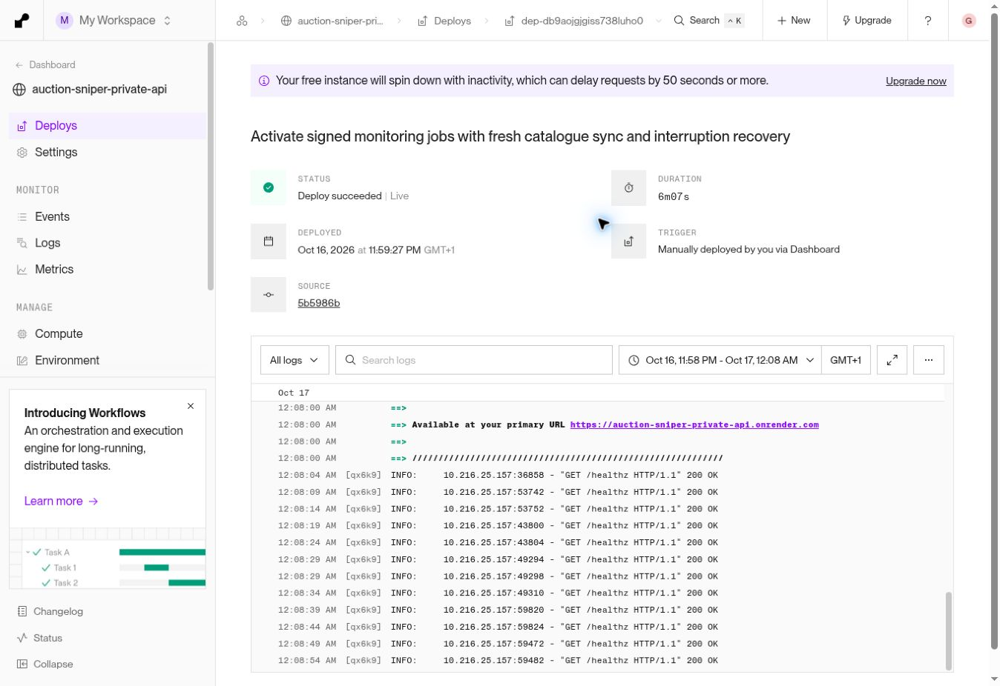

# Scheduled monitoring activation — 16 October 2026

This extends the existing Watch and saved-search worker. It does not send emails,
start paid analysis or change membership/billing entitlements.

## Runtime protections

- `/api/internal/monitor` accepts only a five-minute HMAC signature for that
  exact method/path, using a dedicated monitoring key. Public requests fail
  before accessing account services. Cron does not carry a reusable bearer key.
- A private database lease prevents simultaneous batches; completed checks have
  a ten-minute cooldown. An expired interrupted lease can be retried. Failures
  record only an error class and retain earlier observations.
- The worker fetches the fixed canonical GitHub snapshot, with a 25 MB limit,
  freshness and publication checks, and catalogue parsing before atomic install.
  Customers and scheduled checks then use the same refreshed file.
- Older Watch observations cannot replace newer ones. Private deal changes remain
  independent of public collection freshness. Saved-search archive exclusion,
  source-health protections and transaction deduplication remain in force.
- `/api/admin/monitoring` exposes aggregate last-run status only to the verified
  owner. Public scheduler responses contain no customer records or counts.

## Infrastructure

The existing Supabase project has the private `monitoring_jobs` table, RLS and
backend-only grants. `pg_cron` and `pg_net` are enabled. The invoker-only function
`auction_private.invoke_monitoring()` is executable by the database owner, not
public/anon/authenticated/auction_api roles. It uses the signing key in Vault to
create short-lived request signatures. The same dedicated key is configured in
Render without changing other environment variables.

No paid service has been added. Do not expose `auction_private` via PostgREST.
The scheduled invocation must be enabled only after the new backend endpoint is
live and a signed invocation completes successfully.

## Verification / rollout record

47 local tests passed across monitoring activation, saved-search matching,
Watch, membership and startup. PostgreSQL job claims/recovery are included in CI.

The earlier Watch/search/report-cost release was manually submitted for Render
deployment through the dashboard after multiple newer commits failed to trigger
an automatic deploy. Runtime success must be checked separately from build success.

Backend revision `5b5986bebcd07247637563b8545c90d528c2c6a6` passed hosted
PostgreSQL/browser integration (`38978610511`) and public foundation
(`38978610510`). Render deployment `dep-db9aojgjgiss738luho0` became live at
23:07:59 UTC. API factory startup took 0.79 seconds after module import, with
successful port binding and health checks. This also deploys the preceding Watch,
saved-search and report-cost fixes; earlier checkpoint notes about release
`62012b58` being current are superseded.

The first signed production invocation ran 23:08:37–23:09:46 UTC. Both the HTTP
result and private job record confirm completion: HTTP 200, no timeout, 39 healthy
sources and 97 rows withheld by source-health controls. The catalogue was already
at the current published timestamp, 21:40:04 UTC, so no replacement was needed.
No eligible watched account was processed and no new event/match was generated.
This is infrastructure acceptance, not a genuine customer-alert delivery test.

Supabase Cron job 1, `auction-geek-monitoring`, is active at minutes
11/26/41/56 of every hour (UTC). Its first automatic dispatch at 23:11 UTC
succeeded in Cron and returned HTTP 200 with `already_checked_or_running`, as
expected inside the ten-minute cooldown after the completed manual run. The next
full scheduled check is due at 23:26 UTC; that later result is not yet claimed.

An unsigned production request returned HTTP 401. The readiness endpoint returned
HTTP 200 with accounts ready, owner access configured and billing configured;
live billing, paid-report approval and AI provider configuration all remain false.
The production-email verification flag is still false, distinct from the owner's
earlier successful password-reset delivery.

Owner status display revision `f2d45b2a8` passed local browser checks at
360/390/430/1440px and hosted integration `38979566303`, plus public foundation
`38979566214`. The panel is hidden for non-owners and customer previews; it shows
completion, failure, interrupted runs and overdue checks, without claiming email
delivery. A separate server test confirms a normal customer receives HTTP 403.

Production RLS/grants were inspected: anon/authenticated cannot read the job
table or execute the scheduler function; the existing backend role has table
access only. No secret values are included in this record.

## Remaining launch gates

- Email-alert delivery remains inactive. Render has no Resend/SMTP alert-provider
  setting; verified recipients, preferences, retries and actual inbox delivery
  still need completion. Working Supabase sign-in email is a separate service.
- Render auto-deployment still requires investigation: Git credentials and no
  build filters were verified, but new commits did not start deployments. The
  manual deploy restored freshness; it does not establish reliable auto-updates.
- No AI report provider/key is configured. With/without-pack output quality and
  actual report costs remain unapproved. Paid reports and live billing stay closed.
- Sandbox payment lifecycle, production backup/restore and the complete customer
  journey remain open; earlier fixture successes are not production acceptance.
- Cheffins timed catalogue inspection found three upcoming CPN lots absent from
  the current snapshot. Registry evidence was refreshed; collector reconciliation
  remains required. Other source gaps and Auction House regional sign-off remain.
